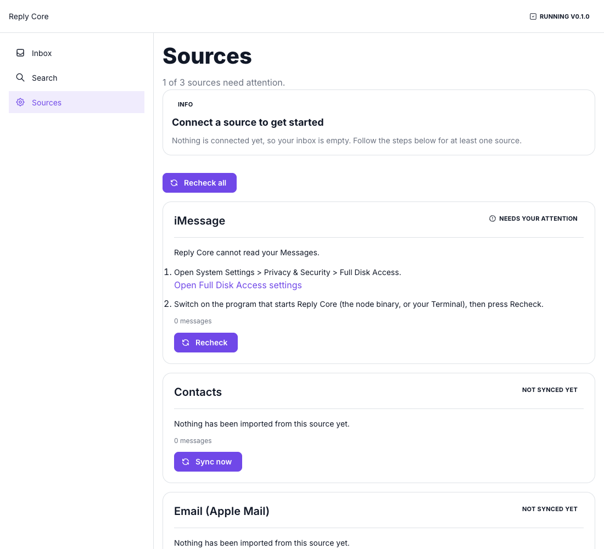
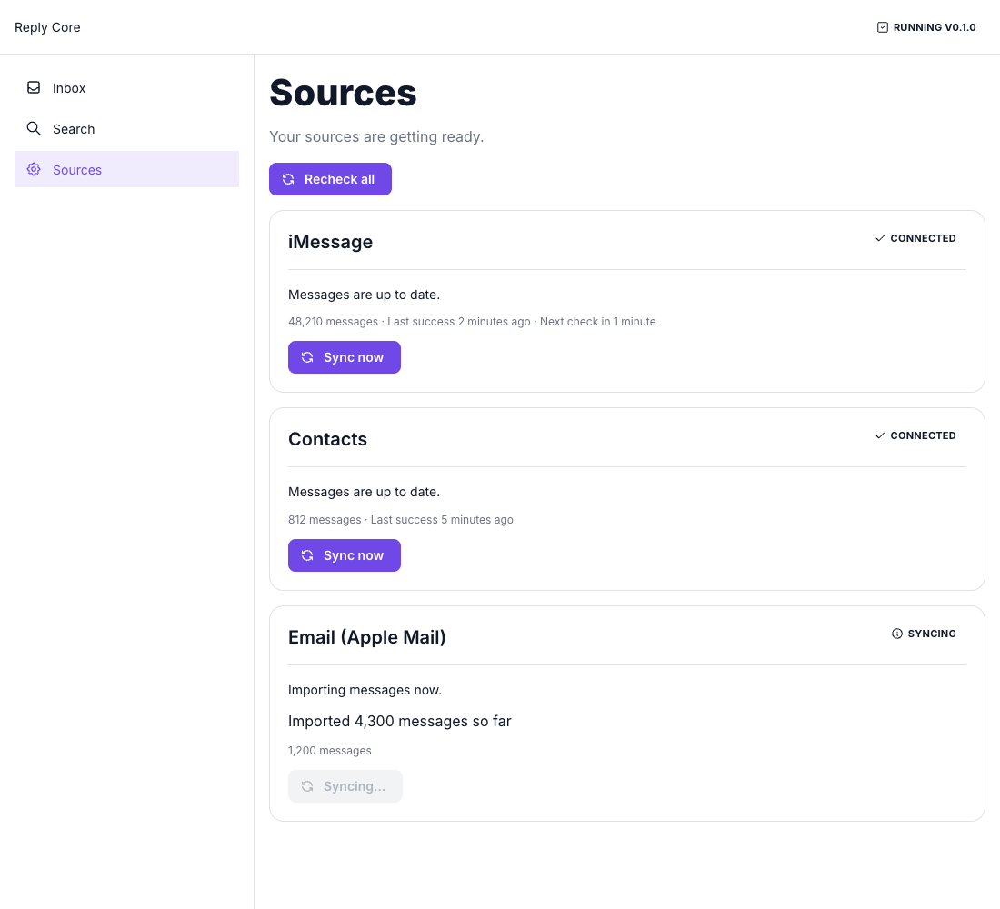

# Reply Core: first run

This is the path from a fresh checkout to a working inbox. It takes about ten minutes, most of it waiting for the first import.

## 1. Start it

```bash
cd core
npm install
GITHUB_TOKEN=<a token with read:packages> npm --prefix ui ci   # the design system comes from GitHub Packages (core/ui/README.md)
node scripts/reply-core start
```

The launcher checks Node (20.17 or newer), builds the web app the first time, starts the service and opens your browser. Because nothing has permission yet, it opens **Sources**:



## 2. Give it permission

macOS decides who may read Messages and Mail. Every source that needs something shows numbered steps:

1. Open **System Settings > Privacy & Security > Full Disk Access** (the link on the screen opens it).
2. Switch on the program that starts Reply Core. That is the `node` binary if you use the start-at-login agent (the command prints its exact path), or your Terminal app if you run `start` there. Use **+** and press Command+Shift+G to paste a path.
3. Come back and press **Recheck**.

The first time Reply Core reads another app's data macOS may also show a permission dialog; answer it, then press **Recheck**. Contacts need their own permission (Privacy & Security > Contacts).

> The System Settings pages themselves are not pictured here: their layout changes between macOS releases. If a step does not match what you see, the source's message on the Sources screen says what is wrong.

## 3. Watch it import

A source that works turns **Connected** and starts importing ("Imported 4,300 messages so far"). The page announces "iMessage is connected." when a blocked source starts working.



## 4. Use the inbox

Open **Inbox**. People appear as soon as their messages are imported. Open a conversation to see every channel in one timeline, use **Reply** to open Messages, Mail or WhatsApp with your text ready (Reply Core never sends anything itself), and **Search** to find a word across everything. See [CORE_UI.md](CORE_UI.md) for the screens.

## 5. Optional: start at login

```bash
node scripts/reply-core install-agent
```

This keeps Reply Core running after you log in and restarts it if it stops. It needs its own Full Disk Access grant for the `node` binary it prints, and that grant has to be repeated after a Node upgrade. Undo it with `uninstall-agent`. Details: [CORE_OPERATIONS.md](CORE_OPERATIONS.md#start-at-login-optional).

## When something is wrong

| You see | Do |
|---|---|
| `Reply Core needs Node 20.17 or newer` (exit 10) | install a current Node and run it again |
| `Could not build the web app` (exit 11) | check the network and `GITHUB_TOKEN`, see `core/ui/README.md` |
| `port 45511 is used by another program` (exit 75) | stop that program, or set `REPLY_CORE_PORT` |
| a source says **Needs your attention** | follow its steps, then **Recheck** |
| the inbox is empty | open **Sources**: an empty inbox with a blocked source is a permission problem, not missing mail |
| anything else | `node scripts/reply-core status` and `node scripts/reply-core logs` |
